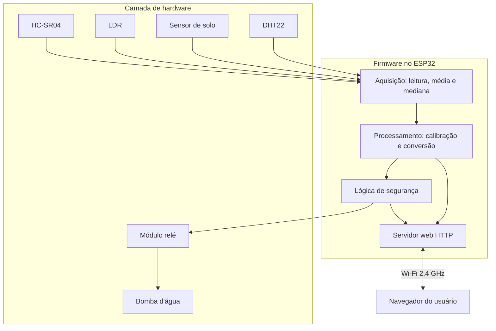

# SATURN---Plant-Keeper[README.md](https://github.com/user-attachments/files/34293844/README.md)
# Estufa Inteligente com ESP32: monitoramento e controle de irrigação via web

> **Aviso sobre este documento:** itens marcados com **[CONFIRMAR]** não foram informados durante o desenvolvimento (modelos, especificações, valores de componentes). Preencha-os antes de publicar. Nenhuma credencial real (Wi-Fi ou login do painel) deve ser colocada neste repositório.

---

## 1. Identificação do projeto

| Item | Descrição |
|---|---|
| **Nome** | Estufa Inteligente (Smart Greenhouse) |
| **Descrição** | Sistema que monitora temperatura, umidade do ar, umidade do solo, luminosidade e nível de água de um reservatório, e permite ligar e desligar uma bomba d'água por uma página web hospedada no próprio ESP32 |
| **Microcontrolador** | ESP32 (modelo exato da placa: **[CONFIRMAR]**, por exemplo DevKit V1) |
| **Categoria** | IoT, monitoramento ambiental e automação (irrigação) |
| **Linguagem / ambiente** | C++ (framework Arduino para ESP32), Arduino IDE |
| **Comunicação** | Wi-Fi 2,4 GHz, HTTP (servidor web local) |
| **Interface** | Página web (HTML, CSS e JavaScript) servida pelo ESP32 |

**Tecnologias utilizadas:** ESP32, Arduino Core para ESP32, bibliotecas `WiFi`, `WebServer` e `DHT`, HTML/CSS/JavaScript, JSON, módulo relé.

---

## 2. Introdução

Este projeto implementa um sistema embarcado de monitoramento e controle para uma estufa de pequeno porte. O ESP32 lê um conjunto de sensores, publica os dados em uma página web acessível pela rede local e permite o acionamento remoto de uma bomba d'água por meio de um módulo relé.

**O que o projeto propõe:** reunir, em um único dispositivo de baixo custo, a leitura das condições ambientais da estufa e o controle da irrigação.

**Funcionalidade principal:** painel web com leituras em tempo quase real e botões para ligar e desligar a bomba.

**Papel do ESP32:** lê os sensores, executa a lógica de segurança, controla o relé, hospeda o servidor web e mantém a conexão Wi-Fi.

**Resultado esperado:** o usuário acompanha as condições da estufa e do reservatório pelo navegador (celular ou computador na mesma rede) e aciona a irrigação sem contato físico com o circuito.

> Contexto de desenvolvimento: projeto de caráter acadêmico, relacionado à disciplina de Conectividade em Sistemas Ciberfísicos **[CONFIRMAR / ajustar]**.

---

## 3. Motivação e justificativa

> Esta seção foi escrita a partir das funções do sistema. **Ajuste-a com a motivação real do projeto.**

- **Necessidade:** acompanhar as condições de cultivo e irrigar sem depender de presença constante no local.
- **Limitações das soluções convencionais:** a irrigação manual depende de memória e rotina do usuário. Temporizadores simples não consideram o estado real do solo nem do reservatório. Soluções comerciais prontas costumam ter custo maior e menor flexibilidade para estudo e modificação.
- **Por que o ESP32:** possui Wi-Fi integrado, múltiplas entradas analógicas e digitais, bom desempenho e baixo custo, o que dispensa módulos de rede adicionais.
- **Benefícios:** visibilidade das condições da estufa, acionamento remoto da bomba, proteção contra funcionamento a seco e base extensível para automação.

---

## 4. Problemas que o projeto busca solucionar

| Problema | Consequências | Como o projeto atua | Tipo |
|---|---|---|---|
| Falta de visibilidade das condições da estufa | Decisões de irrigação baseadas em estimativa | Exibe temperatura, umidade do ar, umidade do solo e luminosidade na página web | **Solucionado** |
| Acionamento da bomba exige presença física | Perda de tempo, irrigação fora de hora | Botões liga/desliga na página web | **Solucionado** |
| Bomba funcionando sem água (a seco) | Desgaste e possível dano à bomba | Medição do nível do reservatório e bloqueio da bomba abaixo de um nível mínimo | **Solucionado** (dentro da precisão do sensor) |
| Bomba ligada por tempo indevido (falha de controle ou de rede) | Excesso de água, esvaziamento do reservatório | Desligamento automático após tempo máximo e desligamento se o Wi-Fi cair | **Impacto reduzido** |
| Irrigação excessiva ou insuficiente | Prejuízo às plantas | O usuário passa a ter os dados do solo para decidir. A irrigação automática por umidade ainda **não** está implementada | **Impacto reduzido** |

---

## 5. Objetivos

### 5.1. Objetivo geral

Desenvolver um sistema embarcado baseado em ESP32 capaz de monitorar as condições ambientais de uma estufa e controlar remotamente a irrigação por meio de uma interface web.

### 5.2. Objetivos específicos

- Ler temperatura e umidade do ar (DHT22).
- Ler a umidade do solo (sensor capacitivo) e a luminosidade (LDR) e convertê-las em porcentagem.
- Medir o nível de água do reservatório (HC-SR04) e estimar o volume.
- Acionar uma bomba d'água por relé, com isolamento entre a lógica do ESP32 e a carga.
- Hospedar um servidor web com autenticação, painel de leituras e comandos da bomba.
- Implementar proteções: tempo máximo de operação, desligamento por perda de Wi-Fi e bloqueio por nível baixo.

---

## 6. Funcionamento do sistema

1. **Inicialização:** o ESP32 configura os pinos, mantém a bomba **desligada**, inicia o DHT22 e conecta ao Wi-Fi (limite de 20 s). O endereço IP é exibido no Monitor Serial.
2. **Aquisição:** a cada 2,5 s, o ESP32 lê o DHT22; lê o solo e o LDR com média de 10 amostras; e mede a distância até a água com o HC-SR04 usando a mediana de 7 leituras.
3. **Processamento:** valores brutos do ADC são convertidos em porcentagem por calibração (valores mínimo e máximo). A distância medida vira nível (%) e volume estimado (ml).
4. **Decisões do microcontrolador:**
   - desliga a bomba após `TEMPO_MAX_BOMBA_MS` (60 s por padrão);
   - desliga a bomba se o Wi-Fi cair;
   - impede (ou interrompe) o acionamento se o nível do reservatório estiver abaixo do mínimo configurado;
   - em falha de leitura do DHT22, indica "erro" na página em vez de exibir valor incorreto.
5. **Acionamento:** o ESP32 comanda o módulo relé pelo pino de sinal. O relé fecha o circuito de alimentação da bomba.
6. **Comunicação:** o ESP32 atua como servidor HTTP na porta 80 com as rotas abaixo.

   | Rota | Função |
   |---|---|
   | `/` | Página do painel |
   | `/status` | JSON com leituras e estado da bomba |
   | `/ligar` | Liga a bomba |
   | `/desligar` | Desliga a bomba |

   Todas as rotas exigem autenticação HTTP básica.
7. **Interação do usuário:** o usuário acessa `http://<IP-do-ESP32>` em um dispositivo na mesma rede, informa login e senha, acompanha os cards de sensores (atualizados a cada 2 s) e usa os botões **LIGAR** e **DESLIGAR**.

**Exemplo de resposta de `/status`:**

```json
{
  "ligada": false,
  "temperatura": 26.4,
  "umidade": 58.1,
  "solo": 42,
  "luminosidade": 73,
  "reservatorio": 65,
  "volume_ml": 325,
  "bloqueada": false
}
```

**Exemplo prático:** o usuário vê o solo em 20% e o reservatório em 65%, aciona a bomba pelo celular, acompanha o solo subir e desliga. Se o reservatório cair abaixo de 10%, o sistema bloqueia a bomba e exibe um aviso.

---

## 7. Componentes eletrônicos e materiais

| Componente | Qtd. | Função no projeto | Especificações técnicas |
|---|---|---|---|
| ESP32 (placa de desenvolvimento) | 1 | Processamento, Wi-Fi, servidor web | Alimentação por USB (5 V); GPIOs de 3,3 V. Modelo: **[CONFIRMAR]** |
| Sensor DHT22 (AM2302) | 1 | Temperatura e umidade do ar | Saída digital de 1 fio. Se for o componente de 4 pinos, requer pull-up (ver seção 8). Versão (módulo ou componente): **[CONFIRMAR]** |
| Sensor capacitivo de umidade do solo V2.0.0 | 1 | Umidade do solo | Pinos GND, VCC e AOUT (saída analógica). Alimentado em 3,3 V neste projeto |
| LDR (fotorresistor) | 1 | Luminosidade ambiente | Usado em divisor de tensão. Modelo: **[CONFIRMAR]** |
| Resistor para o divisor do LDR | 1 | Divisor de tensão do LDR | Valor de referência: 10 kΩ. Valor utilizado: **[CONFIRMAR]** |
| Sensor ultrassônico HC-SR04 | 1 | Nível do reservatório | Alimentação de 5 V; sinal ECHO em 5 V (exige adaptação de nível) |
| Resistores do divisor do ECHO | 2 | Reduzir o ECHO de 5 V para ~3,3 V | Proporção aproximada de 1:2. Valores utilizados: **[CONFIRMAR]** |
| Módulo relé | 1 | Acionar a bomba | Módulo de 1 canal, bobina de 5 V. Lógica do sinal (ativo em LOW ou HIGH): **[CONFIRMAR]**. O código assume ativo em LOW |
| Bomba d'água | 1 | Irrigação | Tensão e corrente: **[CONFIRMAR]** (a alimentação pela MB102 só é adequada para bombas pequenas de 5 V) |
| Módulo de alimentação protoboard MB102 | 1 | Alimentação de 5 V / 3,3 V da bomba, relé e sensores | Saídas de 3,3 V ou 5 V selecionáveis. Regulador de baixa corrente (referência: ~700 mA). Entrada de fonte externa: **[CONFIRMAR]** |
| Diodo 1N4007 | 1 | Proteção contra pico de tensão da bomba (flyback) | Recomendado, em paralelo com a bomba, cátodo no positivo. Uso na montagem: **[CONFIRMAR]** |
| Protoboard e jumpers | — | Montagem | — |
| Reservatório de água | 1 | Armazenamento | Dimensões e capacidade: **[CONFIRMAR]** (usadas na calibração) |

---

## 8. Projeto elétrico e conexões

### A. Arquitetura elétrica

- **ESP32:** alimentado pela porta USB.
- **MB102:** fornece 5 V para a bomba (via relé), para o módulo relé e para o HC-SR04, conforme a montagem.
- **Terra comum:** o GND do ESP32, da MB102, do relé e de todos os sensores deve ser **interligado**.
- **Carga isolada do ESP32:** a bomba é acionada pelos contatos do relé (COM e NO) e nunca é alimentada pelo ESP32.
- **Entradas do ESP32:** DHT22 (digital), solo e LDR (analógicas, ADC1) e ECHO do HC-SR04 (digital).
- **Saídas do ESP32:** sinal do relé e TRIG do HC-SR04.

### B. Pinout (conexões do projeto)

| ESP32 (GPIO) | Componente | Pino do componente | Tipo | Finalidade |
|---|---|---|---|---|
| GPIO 13 | Módulo relé | IN | Saída digital | Acionar a bomba |
| GPIO 19 | DHT22 | DATA | Digital bidirecional | Temperatura e umidade do ar |
| GPIO 32 | Sensor de solo | AOUT | Entrada analógica (ADC1) | Umidade do solo |
| GPIO 34 | LDR (divisor) | Ponto central do divisor | Entrada analógica (ADC1) | Luminosidade |
| GPIO 25 | HC-SR04 | TRIG | Saída digital | Disparo do pulso ultrassônico |
| GPIO 26 | HC-SR04 | ECHO (via divisor) | Entrada digital | Leitura do eco |
| 3V3 | DHT22, sensor de solo, LDR | VCC / terminal do divisor | Alimentação | Energia dos sensores |
| 5V (MB102 ou VIN) | Módulo relé, HC-SR04 | VCC | Alimentação | Energia do relé e do HC-SR04 |
| GND | Todos os componentes | GND | Terra | Referência elétrica comum |

> Os GPIOs 25 e 26 constam no código atual. Confirme-os na montagem física. O pino de alimentação do DHT22 (3,3 V ou 5 V) também deve ser **[CONFIRMAR]**.

### C. Alimentação e requisitos elétricos

- **ESP32:** 5 V via USB. Os GPIOs operam em **3,3 V** e **não são tolerantes a 5 V**.
- **Periféricos:**

  | Periférico | Tensão |
  |---|---|
  | DHT22 | 3,3 V (faixa típica 3,3 a 5 V) |
  | Sensor de solo capacitivo | 3,3 V (mantém a saída analógica ≤ 3,3 V) |
  | LDR | 3,3 V |
  | HC-SR04 | 5 V |
  | Módulo relé | 5 V (bobina) |
  | Bomba | **[CONFIRMAR]** |

- **Níveis lógicos:** o ECHO do HC-SR04 sai em 5 V e **precisa de divisor resistivo** antes do GPIO 26. A proporção deve ser aproximadamente 1:2 (resistor do GND com o dobro do resistor em série). Evite dois resistores iguais, pois resultam em ~2,5 V, no limite do nível alto do ESP32.
- **Corrente:** a MB102 usa regulador de baixa corrente. A corrente de partida da bomba é maior que a nominal. Se a bomba exceder ~500 mA ou for de 12 V, use uma fonte externa dedicada, mantendo o GND comum.
- **Módulo relé:** em módulos com jumper **JD-VCC**, ele deve estar colocado entre JD-VCC e VCC para energizar a bobina.
- **Proteção da bomba:** diodo 1N4007 em paralelo com os terminais da bomba (recomendado).
- **Evite duas fontes no ESP32:** não alimente a placa pelo USB e pelo VIN ao mesmo tempo.

### D. Descrição das conexões

- **Módulo relé:** VCC em 5 V, GND comum e IN no GPIO 13. Na parte de potência, o positivo da fonte da bomba vai ao **COM** e o fio positivo da bomba ao **NO**. O fio negativo da bomba retorna ao GND da fonte.
- **DHT22:** DATA no GPIO 19, VCC e GND. No componente de 4 pinos, use resistor de **10 kΩ entre VCC e DATA** (o módulo de 3 pinos já possui). O DATA exige pino bidirecional, por isso **não** deve ser ligado a GPIOs 34, 35, 36 ou 39.
- **Sensor de solo:** VCC em 3,3 V, GND e AOUT no GPIO 32. Mantenha a eletrônica fora do solo e enterre apenas a ponta, até a linha branca.
- **LDR:** divisor de tensão. Um terminal do LDR em 3,3 V, o outro no GPIO 34 e em um resistor que vai ao GND.

  ```text
  3V3 ──── LDR ────┬──── GPIO 34
                   │
                 Resistor (ref. 10 kΩ)
                   │
                  GND
  ```

- **HC-SR04:** VCC em 5 V, GND comum, TRIG no GPIO 25 e ECHO no GPIO 26 **através do divisor**.

  ```text
  ECHO ──[ R1 ]──┬── GPIO 26
                 │
               [ R2 ]   (R2 ≈ 2 × R1)
                 │
                GND
  ```

### E. Diagrama elétrico


> **Pendente:** o diagrama ainda deve ser elaborado (por exemplo, no Fritzing ou KiCad) e salvo em `docs/images/diagrama-eletrico.png`.

### F. Cuidados e observações técnicas

- **GPIOs:** operam a 3,3 V. Nunca aplique 5 V diretamente (o ECHO exige divisor).
- **ADC e Wi-Fi:** use apenas pinos do **ADC1** (32, 33, 34, 35, 36, 39) para leituras analógicas. O ADC2 não funciona com o Wi-Fi ativo.
- **Pinos somente entrada** (34, 35, 36, 39): não servem para saída nem para o DATA do DHT22. Isso já causou erro de leitura em testes.
- **Pinos de boot** (0, 2, 12, 15): evite ligar periféricos a eles, pois podem impedir a gravação ou a inicialização.
- **Terra comum:** sem GND comum entre ESP32, MB102, relé e sensores, o relé pode não acionar de forma confiável. Trilhos de GND da protoboard podem estar divididos ao meio. Confira a continuidade.
- **Relé e bomba:** nunca alimente a bomba pelo ESP32. Use COM e NO (não NC).
- **Alimentação:** tensão baixa ou queda na partida da bomba pode causar reinicializações (brownout).
- **Polaridade e curto-circuito:** confira polaridade da bomba, do diodo e das fontes antes de energizar. Teste a bomba por poucos segundos antes de usá-la na água.
- **HC-SR04:** não mede bem abaixo de ~2 a 4 cm. Posicione-o de modo que a água, com o reservatório cheio, fique a pelo menos 4 cm dele. Não é à prova d'água.
- **Segurança da rede:** a autenticação HTTP básica **sem HTTPS** é fraca. Não exponha o ESP32 diretamente à internet (não abra portas no roteador).

---

## 9. Arquitetura do sistema



| Camada | Descrição |
|---|---|
| **Hardware** | ESP32, sensores, relé, bomba e alimentação |
| **Aquisição de dados** | Leitura periódica (2,5 s) com média (solo e LDR) e mediana (HC-SR04) para reduzir ruído |
| **Processamento** | Calibração e conversão para %, cálculo de nível e volume |
| **Controle e segurança** | Tempo máximo da bomba, desligamento por perda de Wi-Fi, bloqueio por nível baixo |
| **Comunicação** | Wi-Fi em modo estação e servidor HTTP com autenticação básica |
| **Aplicação / interface** | Página HTML/CSS/JS que consulta `/status` a cada 2 s e envia comandos |

---

## 10. Tecnologias e ferramentas

| Categoria | Item |
|---|---|
| Microcontrolador | ESP32 |
| Linguagem | C++ (Arduino) para o firmware. HTML, CSS e JavaScript para a interface |
| Ambiente | Arduino IDE com suporte a placas ESP32 |
| Bibliotecas | `WiFi.h`, `WebServer.h` (Arduino Core ESP32); **DHT sensor library** (Adafruit); **Adafruit Unified Sensor** |
| Protocolos | Wi-Fi (IEEE 802.11 b/g/n, 2,4 GHz), HTTP, JSON |
| Simulação / modelagem eletrônica | **[CONFIRMAR]** (por exemplo, Fritzing, KiCad ou Wokwi) |
| Versionamento | Git e GitHub |

---

## 11. Estrutura de diretórios sugerida

```text
estufa-inteligente-esp32/
│
├── docs/
│   └── images/
│       ├── diagrama-eletrico.png      # a ser elaborado
│       └── painel-web.png             # captura de tela da interface
│
├── src/
│   └── estufa_esp32/
│       ├── estufa_esp32.ino           # firmware principal
│       └── secrets.example.h          # modelo das credenciais (sem dados reais)
│
├── .gitignore                         # deve ignorar secrets.h
├── LICENSE
└── README.md
```

---

## 12. Instalação e configuração

1. Instale a **Arduino IDE** e o suporte a placas **ESP32** (Gerenciador de Placas).
2. Em *Gerenciar Bibliotecas*, instale **DHT sensor library** e **Adafruit Unified Sensor**.
3. Abra o firmware e configure as constantes de credenciais **sem versioná-las**:

   ```cpp
   const char* WIFI_SSID   = "NOME_DA_REDE";
   const char* WIFI_SENHA  = "SENHA_DA_REDE";
   const char* WEB_USUARIO = "USUARIO_DO_PAINEL";
   const char* WEB_SENHA   = "SENHA_DO_PAINEL";
   ```

   > **Importante:** não faça commit de senhas reais. Mantenha-as em um arquivo separado (`secrets.h`) listado no `.gitignore`.
4. Selecione a placa (ESP32 Dev Module) e a porta, e grave o código.
5. Abra o Monitor Serial a **115200 baud**, aguarde o IP e acesse `http://<IP>` em um dispositivo na **mesma rede**.

### Parâmetros principais

| Constante | Função | Padrão |
|---|---|---|
| `RELE_ATIVO_LOW` | `true` se o relé liga com nível baixo | `true` |
| `TEMPO_MAX_BOMBA_MS` | Tempo máximo de bomba ligada | `60000` |
| `INTERVALO_SENSORES_MS` | Intervalo entre leituras | `2500` |
| `PROTEGER_BOMBA_NIVEL_BAIXO` | Ativa o bloqueio por nível baixo | `true` |
| `NIVEL_MINIMO_BOMBA_PCT` | Nível mínimo para operar a bomba | `10` |

### Calibração dos sensores

| Sensor | Constantes | Procedimento |
|---|---|---|
| Solo | `SOLO_SECO`, `SOLO_MOLHADO` | Leia o valor bruto no Monitor Serial com o sensor no ar (seco) e com a ponta na água (molhado). Este sensor dá valor alto no seco |
| LDR | `LDR_ESCURO`, `LDR_CLARO` | Leia o valor bruto com o sensor tampado e com luz intensa |
| Reservatório | `DIST_VAZIO_CM`, `DIST_CHEIO_CM`, `CAPACIDADE_ML` | Leia a distância com o reservatório vazio e cheio e informe a capacidade real |

---

## 13. Limitações conhecidas e melhorias futuras

**Limitações**
- O acionamento da bomba é **manual**: a irrigação automática com base na umidade do solo ainda não existe.
- O acesso é limitado à rede local. A autenticação básica sem HTTPS não é adequada para exposição na internet.
- O volume em ml assume reservatório de paredes retas.
- Se o Wi-Fi não conectar no boot, o painel só fica disponível após a reconexão.

**Melhorias possíveis**
- Irrigação automática por limite de umidade do solo, com histerese.
- Horário via NTP, agendamento de irrigação e registro de leituras.
- Comunicação por MQTT para acesso remoto seguro.
- Histórico e gráficos de leituras.
- Uso de HTTPS ou túnel seguro para acesso externo.

---

## 14. Licença

Defina a licença do projeto (por exemplo, MIT) no arquivo `LICENSE`. **[CONFIRMAR]**
